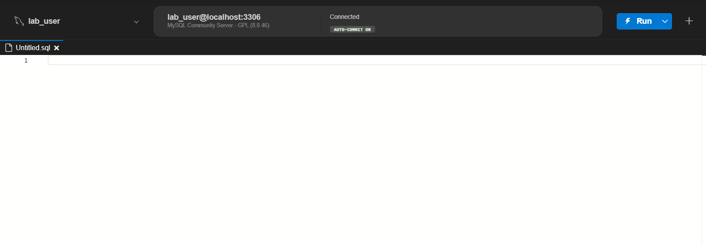
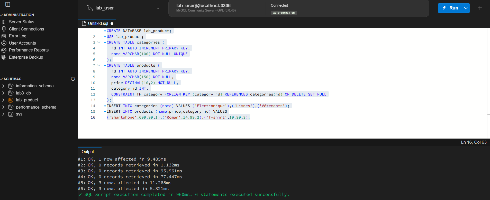
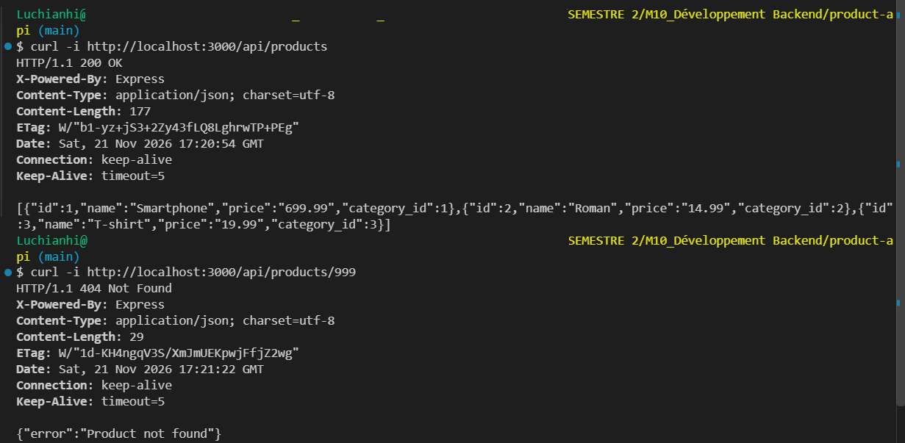
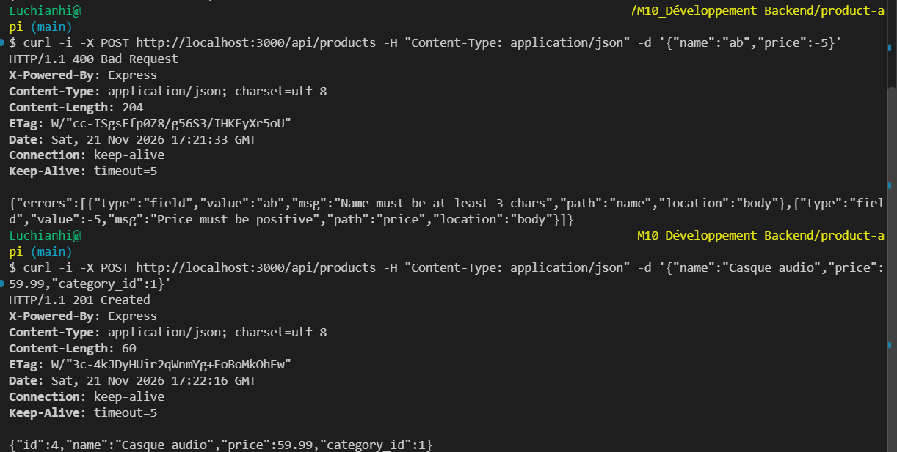
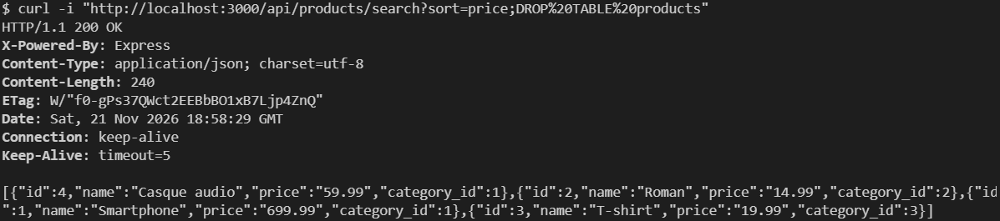
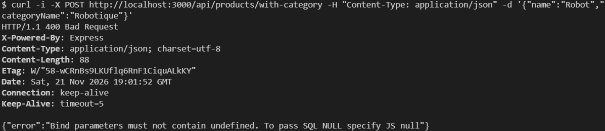
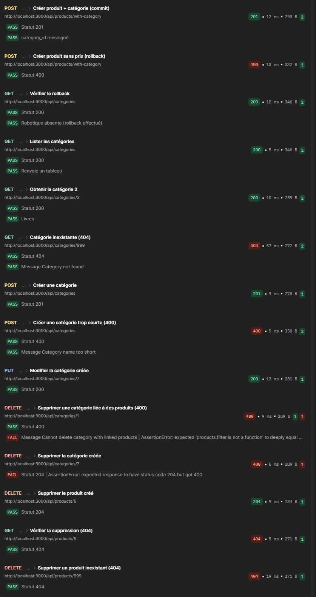

# TP06-Backend – Intégration MySQL et gestion asynchrone avec Node.js

API REST **Node.js / Express** connectée à **MySQL** : architecture en couches (Routes → Controllers → Services → Repositories), pool de connexions `mysql2`, requêtes paramétrées, validation avec `express-validator`, gestion centralisée des erreurs, recherche paginée et transactions.

> LAB 6 – Module M10 « Développement Backend avec Java, Node.js et PHP » – Master IAIDDWM, semestre 2.

---

## Sommaire

1. [Objectifs](#objectifs)
2. [Technologies](#technologies)
3. [Architecture du projet](#architecture-du-projet)
4. [Installation et lancement](#installation-et-lancement)
5. [Endpoints de l'API](#endpoints-de-lapi)
6. [Déroulement du lab, étape par étape](#déroulement-du-lab-étape-par-étape)
7. [Résultats des tests Postman](#résultats-des-tests-postman)
8. [Point connu](#point-connu)

---

## Objectifs

- Comprendre l'intégration de MySQL dans une application Node.js.
- Maîtriser la programmation asynchrone avec `async/await`.
- Appliquer une architecture en couches (Routes-Controllers-Services-Repositories).

## Technologies

| Outil | Rôle |
| --- | --- |
| Node.js 24 LTS / npm 11 | Environnement d'exécution |
| Express | Serveur HTTP et routage |
| mysql2 (`mysql2/promise`) | Pool de connexions MySQL, requêtes paramétrées |
| dotenv | Variables d'environnement (`.env`) |
| express-validator | Validation des données entrantes |
| nodemon | Rechargement automatique en développement |
| MySQL Community Server 8.0 + MySQL Workbench | Base de données |
| Postman / curl | Tests des endpoints |

## Architecture du projet

```
product-api/
├─ .env                      # non versionné (voir Installation)
├─ .gitignore
├─ package.json
├─ index.js                  # point d'entrée
├─ postman/
│  └─ Product API.postman_collection.json
├─ src/
│  ├─ config/db.js           # pool mysql2
│  ├─ routes/                # productRoutes.js, categoryRoutes.js
│  ├─ controllers/           # productController.js, categoryController.js
│  ├─ services/              # productService.js, categoryService.js
│  ├─ repositories/          # productRepository.js, categoryRepository.js
│  └─ middlewares/           # validation.js, errorHandler.js
└─ sql/
   ├─ create_database.sql
   └─ seed_data.sql
```

Le trajet d'une requête : **Route** → middleware de validation → **Controller** → **Service** (règles métier) → **Repository** (SQL) → MySQL. Toute erreur est transmise par `next(err)` au middleware `errorHandler`, qui renvoie `404` si le message contient « not found », sinon `400`.

## Installation et lancement

**Prérequis :** Node.js LTS, MySQL Server 8, MySQL Workbench.

1. Cloner le dépôt et installer les dépendances :

   ```bash
   git clone https://github.com/<votre-utilisateur>/TP06-Backend.git
   cd TP06-Backend
   npm install
   ```

2. Dans MySQL Workbench (compte `root`), créer l'utilisateur dédié :

   ```sql
   CREATE USER 'lab_user'@'localhost' IDENTIFIED BY 'LabPass123!';
   GRANT ALL PRIVILEGES ON *.* TO 'lab_user'@'localhost';
   FLUSH PRIVILEGES;
   ```

3. Exécuter `sql/create_database.sql`, puis `sql/seed_data.sql`.

4. Créer un fichier `.env` à la racine (il n'est pas versionné) :

   ```
   DB_HOST=localhost
   DB_USER=lab_user
   DB_PASSWORD=LabPass123!
   DB_NAME=lab_product
   DB_PORT=3306
   PORT=3000
   ```

5. Démarrer le serveur :

   ```bash
   npm start
   ```

   Le terminal affiche `Server running on port 3000`.

## Endpoints de l'API

Base : `http://localhost:3000/api`

| Méthode | Route | Description | Statuts |
| --- | --- | --- | --- |
| GET | `/products` | Liste des produits | 200 |
| GET | `/products/:id` | Détail d'un produit | 200, 404 |
| GET | `/products/search` | Recherche : `name`, `minPrice`, `maxPrice`, `categoryId`, `sort`, `limit`, `offset` | 200 |
| POST | `/products` | Création (validée) | 201, 400 |
| POST | `/products/with-category` | Création produit + catégorie dans une transaction | 201, 400 |
| PUT | `/products/:id` | Modification (validée) | 200, 400, 404 |
| DELETE | `/products/:id` | Suppression | 204, 404 |
| GET | `/categories` | Liste des catégories | 200 |
| GET | `/categories/:id` | Détail d'une catégorie | 200, 404 |
| POST | `/categories` | Création (validée) | 201, 400 |
| PUT | `/categories/:id` | Modification (validée) | 200, 400, 404 |
| DELETE | `/categories/:id` | Suppression (refusée si des produits sont liés) | 204, 400 |

---

## Déroulement du lab, étape par étape

### Étapes 1 à 3 – Initialisation du projet et de Git

Création du dossier `product-api`, `npm init -y`, installation de `express`, `mysql2`, `dotenv`, `express-validator` et de `nodemon` (script `start` : `nodemon index.js`). Dépôt Git initialisé avec un `.gitignore` excluant `node_modules/` et `.env`.

### Étape 4 – Installation et configuration de MySQL

Création de l'utilisateur dédié `lab_user`, puis connexion à MySQL Workbench avec ce compte.



### Étape 5 – Création de la base de données et des tables

Exécution du script de création de `lab_product`, des tables `categories` et `products` (clé étrangère `fk_category`, `ON DELETE SET NULL`) et des données de test.



Vérification des données insérées : 3 catégories et 3 produits.


### Étapes 6 et 7 – Variables d'environnement et pool de connexions

Paramètres de connexion dans `.env`, chargés par `dotenv` au début de `index.js`. Le pool `mysql2/promise` est défini dans `src/config/db.js`. Premier démarrage du serveur :


### Étapes 8 à 14 – Architecture en couches

- **Étape 8 :** organisation `routes / controllers / services / repositories / middlewares`.
- **Étapes 9 et 10 :** repositories Product et Category (CRUD, requêtes paramétrées `?`).
- **Étapes 11 et 12 :** services Product et Category (règles métier : existence du produit, validité de `category_id`, suppression de catégorie liée interdite).
- **Étapes 13 et 14 :** contrôleurs Product et Category (`async/await`, erreurs transmises via `next(err)`).

### Étapes 15 et 16 – Validation et gestion globale des erreurs

Les routes sont branchées sous `/api`. Le middleware `errorHandler` renvoie une réponse JSON cohérente : `200` pour la liste, `404` pour un produit inexistant.



`express-validator` rejette les données invalides (`400` avec le tableau `errors`). Une création valide renvoie `201`.



### Étape 17 – Recherche, filtrage, pagination et tri

`GET /api/products/search` avec filtres, tri et pagination :


Le paramètre `sort` est limité à une liste de colonnes autorisées : une tentative d'injection SQL est ignorée et la table reste intacte.



### Étape 18 – Transactions MySQL

Création d'un produit et de sa catégorie dans une même transaction (`commit`) :


En cas d'erreur (prix manquant), la transaction est annulée (`rollback`) : la catégorie « Robotique » n'est pas créée.



### Étape 19 – Tests des endpoints avec Postman et curl

La collection `postman/Product API.postman_collection.json` regroupe 26 requêtes et 45 tests automatiques (CRUD, recherche, pagination, transaction, nettoyage), exécutés avec le Runner de Postman.




### Étape 20 – Arborescence finale et scripts SQL

Voir [Architecture du projet](#architecture-du-projet). Les scripts de `sql/` permettent de réinitialiser la base avant une démonstration :

```sql
DROP DATABASE IF EXISTS lab_product;
-- puis exécuter create_database.sql et seed_data.sql
```

### Étape 21 – Conclusion

Acquis : configuration de MySQL et de tables relationnelles, `mysql2` avec un pool et des requêtes paramétrées, architecture en couches, programmation asynchrone et gestion d'erreurs, CRUD, filtres avancés, validation et transactions.

Pistes suivantes : tests unitaires (Jest, supertest), documentation Swagger, comparaison avec un ORM (Sequelize, TypeORM).

---

## Résultats des tests Postman

| Tests | Réussis | Échoués | Erreurs | Temps moyen |
| --- | --- | --- | --- | --- |
| 45 | 43 | 2 | 0 | 27 ms |

Les 2 échecs concernent la suppression de catégorie et ont une seule cause, décrite ci-dessous.

## Point connu

Dans `src/services/categoryService.js` (code fourni par l'énoncé, étape 12), la fonction `deleteCategory` contient :

```javascript
const [products] = await productRepo.getAll();
const linked = products.filter(p => p.category_id === id);
```

`productRepo.getAll()` renvoie déjà le tableau des lignes. La déstructuration ne récupère donc que le premier produit, et `products.filter` lève `products.filter is not a function`. Toute suppression de catégorie répond alors `400`. De plus, `id` (issu de `req.params`) est une chaîne, alors que `category_id` est un nombre.

Correction proposée, qui fait passer les 45 tests :

```javascript
const products = await productRepo.getAll();
const linked = products.filter(p => p.category_id === Number(id));
```

---

**Auteur :** Luchianhi – Master IAIDDWM, M10 Développement Backend.
